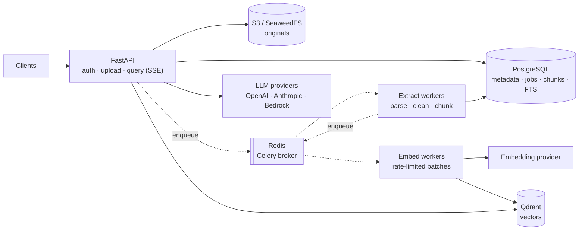

# NexusRAG

[](https://github.com/iprime2/nexus-rag/actions/workflows/ci.yml)

**Distributed Enterprise Retrieval-Augmented Generation Platform**

NexusRAG is a multi-tenant document intelligence backend. It ingests batches of 500–1,000+ documents through horizontally scalable workers, indexes them for hybrid (semantic + keyword) retrieval, and answers questions with streamed, cited responses, restricted to documents the caller is authorized to see.

The focus is the engineering a production RAG system needs and a demo skips:

- **Reliable ingestion:** at-least-once delivery with idempotent processing, crash recovery, retries with backoff, dead-lettering, and global rate limiting of embedding providers.
- **Hard tenant isolation:** enforced by credentials, database constraints, mandatory vector filters and post-retrieval verification. Never by the LLM.
- **Measured quality and performance:** a reproducible evaluation set and benchmarks. No unmeasured claims.

> **Status:** Phase 1 (project foundation) in progress. See [docs/PROJECT_STATUS.md](docs/PROJECT_STATUS.md).

## Architecture



| Layer | Technology |
|---|---|
| API | Python 3.12+, FastAPI, Pydantic, Uvicorn |
| Background processing | Celery, Redis |
| Data | PostgreSQL (SQLAlchemy 2, Alembic), Qdrant, S3 (SeaweedFS locally) |
| AI | OpenAI, Anthropic, AWS Bedrock (behind provider interfaces); optional reranker |
| Observability | Prometheus, Grafana, structured logs, OpenTelemetry |
| Infrastructure | Docker Compose (local), AWS ECS / ECR / S3 / Secrets Manager / CloudWatch, Terraform |

The long-term vision diagram (including graph retrieval, agents and self-hosted models) is in [docs/diagrams/reference-architecture-vision.webp](docs/diagrams/reference-architecture-vision.webp). Those components are **deliberately deferred** until evaluation evidence justifies them; see [ADR-0009](docs/adr/0009-scope-relative-to-reference-diagram.md).

## Documentation

| Start here | |
|---|---|
| [System design](docs/system-design.md) | Entry point: key decisions, scalability, HA, security, failure scenarios |
| [Requirements](docs/requirements.md) | Functional and non-functional requirements, assumptions, open questions |
| [Architecture](docs/architecture.md) | Components, sync/async paths, deployment views, repository layout |
| [Ingestion workflow](docs/ingestion-workflow.md) | State machine, idempotency, retries, backpressure |
| [Retrieval workflow](docs/retrieval-workflow.md) | Hybrid search, RRF, reranking, citations, prompt-injection model |
| [Database design](docs/database-design.md) | Schema, ER diagram, constraints, transactions |
| [API specification](docs/api-specification.md) | REST + SSE contract |
| [Testing strategy](docs/testing-strategy.md) | Test layers, failure and security test matrices |
| [ADRs](docs/adr/) | Architecture decision records |
| [Learning notes](docs/learning/) | Concepts and interview prep per phase |

## Roadmap

0. System design ✅
1. Project foundation (FastAPI, Postgres, Redis, Qdrant, Docker Compose, config, logging, tests) ← **current**
2. Document ingestion (upload, validation, Celery workers, extraction, chunking)
3. Embeddings and vector storage
4. Retrieval and generation (hybrid search, reranking, citations, streaming)
5. Reliability and multi-tenancy
6. Evaluation and observability
7. Performance and scalability benchmarks
8. AWS deployment
9. Portfolio readiness

## Getting started

Requirements: [uv](https://docs.astral.sh/uv/) (it installs the right Python version for you).

```bash
uv sync
```

```bash
uv run pre-commit install
```

```bash
cp .env.example .env
```

```bash
uv run uvicorn app.main:create_app --factory --reload
```

Then open <http://localhost:8000/docs> (interactive API docs), <http://localhost:8000/health/live> (process is up) or <http://localhost:8000/health/ready> (all dependencies reachable; needs the Compose services).

### Tenants and API keys

```bash
uv run python -m app.cli create-tenant --slug acme --name "Acme Corp"
```

```bash
uv run python -m app.cli create-api-key --tenant acme --name local-dev
```

Call the API with `Authorization: ApiKey <key>`, e.g. `GET /v1/me`. In Compose, prefix the commands with `docker compose exec api` instead of `uv run`.

### Database migrations

```bash
uv run alembic upgrade head
```

In Docker Compose, the one-off `migrate` service runs this automatically before the API starts.

### Quality checks

```bash
uv run ruff check . && uv run ruff format --check . && uv run mypy && uv run pytest --cov
```

Integration tests need the backing services (`docker compose up -d postgres redis qdrant object-store`) and a `.env` copied from `.env.example`. They are opt-in:

```bash
uv run pytest -m integration
```

### Full stack with Docker Compose

Requirements: Docker with Compose v2.24+.

```bash
docker compose up -d --build
```

```bash
docker compose ps
```

| Service | Local address | Purpose |
|---|---|---|
| `api` | <http://localhost:8000> | NexusRAG API |
| `postgres` | `localhost:5432` (user/db `nexus`) | Metadata, jobs, chunks |
| `redis` | `localhost:6379` | Celery broker (AOF, `noeviction`) |
| `qdrant` | <http://localhost:6333/dashboard> | Vector store |
| `object-store` | <http://localhost:8333> | S3-compatible storage (SeaweedFS) |

All ports bind to `127.0.0.1`. Credentials in `docker-compose.yml` are local-only defaults; override them from your shell (e.g. `POSTGRES_PASSWORD=… docker compose up -d`). Stop with `docker compose down` (keeps data) or `docker compose down -v` (deletes data).
