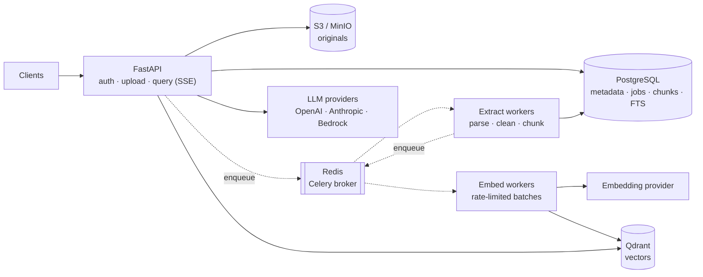

# NexusRAG

**Distributed Enterprise Retrieval-Augmented Generation Platform**

NexusRAG is a multi-tenant document intelligence backend. It ingests batches of 500–1,000+ documents through horizontally scalable workers, indexes them for hybrid (semantic + keyword) retrieval, and answers questions with streamed, cited responses, restricted to documents the caller is authorized to see.

The focus is the engineering a production RAG system needs and a demo skips:

- **Reliable ingestion:** at-least-once delivery with idempotent processing, crash recovery, retries with backoff, dead-lettering, and global rate limiting of embedding providers.
- **Hard tenant isolation:** enforced by credentials, database constraints, mandatory vector filters and post-retrieval verification. Never by the LLM.
- **Measured quality and performance:** a reproducible evaluation set and benchmarks. No unmeasured claims.

> **Status:** Phase 0 (system design) is under review. No application code yet. See [docs/PROJECT_STATUS.md](docs/PROJECT_STATUS.md).

## Architecture

| Layer | Technology |
|---|---|
| API | Python 3.12+, FastAPI, Pydantic, Uvicorn |
| Background processing | Celery, Redis |
| Data | PostgreSQL (SQLAlchemy 2, Alembic), Qdrant, S3 / MinIO |
| AI | OpenAI, Anthropic, AWS Bedrock (behind provider interfaces); optional reranker |
| Observability | Prometheus, Grafana, structured logs, OpenTelemetry |
| Infrastructure | Docker Compose (local), AWS ECS / ECR / S3 / Secrets Manager / CloudWatch, Terraform |

The long-term vision diagram (including graph retrieval, agents and self-hosted models) is in [docs/diagrams/reference-architecture-vision.webp](docs/diagrams/reference-architecture-vision.webp). Those components are **deliberately deferred** until evaluation evidence justifies them; see [ADR-0009](docs/adr/0009-scope-relative-to-reference-diagram.md).

## Documentation

| Start here | |
|---|---|
| [System design](docs/system-design.md) | Entry point: key decisions, scalability, HA, security, failure scenarios |
| [Requirements](docs/requirements.md) | Functional and non-functional requirements, assumptions, open questions |
| [Architecture](docs/architecture.md) | Components, sync/async paths, deployment views, repository layout |
| [Ingestion workflow](docs/ingestion-workflow.md) | State machine, idempotency, retries, backpressure |
| [Retrieval workflow](docs/retrieval-workflow.md) | Hybrid search, RRF, reranking, citations, prompt-injection model |
| [Database design](docs/database-design.md) | Schema, ER diagram, constraints, transactions |
| [API specification](docs/api-specification.md) | REST + SSE contract |
| [Testing strategy](docs/testing-strategy.md) | Test layers, failure and security test matrices |
| [ADRs](docs/adr/) | Architecture decision records |
| [Learning notes](docs/learning/) | Concepts and interview prep per phase |

## Roadmap

0. System design ← **current**
1. Project foundation (FastAPI, Postgres, Redis, Qdrant, Docker Compose, config, logging, tests)
2. Document ingestion (upload, validation, Celery workers, extraction, chunking)
3. Embeddings and vector storage
4. Retrieval and generation (hybrid search, reranking, citations, streaming)
5. Reliability and multi-tenancy
6. Evaluation and observability
7. Performance and scalability benchmarks
8. AWS deployment
9. Portfolio readiness

## Getting started

_Available from Phase 1._
