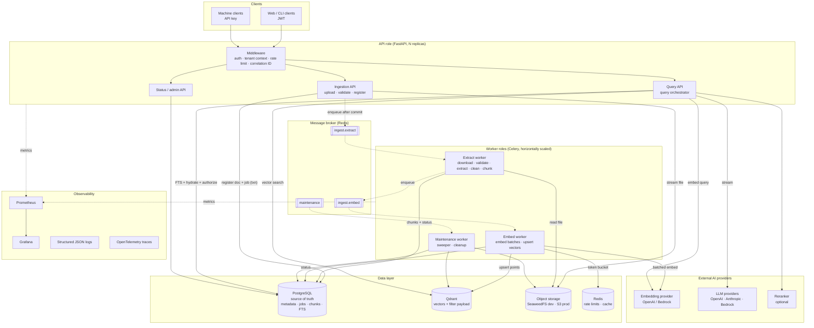
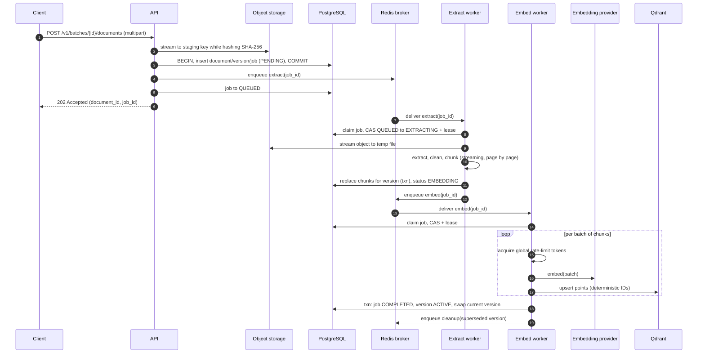
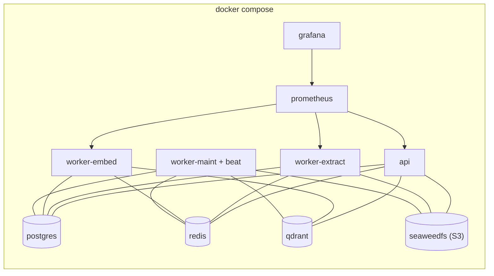

# NexusRAG — Architecture

> Status: **Proposed (Phase 0)**. See [system-design.md](system-design.md) for the cross-cutting design (reliability, scaling, security) and [adr/](adr/) for individual decisions.

## 1. Architectural style: a modular monolith with separate process roles

NexusRAG is **one Python codebase and one container image** that runs in different **process roles**:

| Role | Process | Scales on | Why it is separate |
|---|---|---|---|
| `api` | Uvicorn + FastAPI | Request rate, open SSE connections | Latency-sensitive. Must never block on document processing. |
| `worker-extract` | Celery, queue `ingest.extract` | CPU (PDF parsing, chunking) | CPU-bound. Concurrency ≈ CPU cores. |
| `worker-embed` | Celery, queue `ingest.embed` | Embedding provider rate limit | I/O-bound, waiting on the provider. Higher concurrency, globally rate-limited. |
| `worker-maint` | Celery, queue `maintenance` + Celery beat | — | Sweeper (recovers stuck jobs), deletion cleanup, superseded-version cleanup. |

Inside the codebase, **ingestion** and **query** are separate modules with no imports between them. They share only the database models, configuration and provider interfaces. That keeps the option of deploying the query routes as their own `query-api` service, from the same image with a different router set, once benchmarks show that upload traffic and streaming queries interfere.

**Why not microservices now?** Separate services would add network hops, distributed transactions across service boundaries, and separate deployments, all before there is evidence they are needed. The workload split that *does* matter, request handling versus heavy processing, is already achieved by the process roles. More detail in [ADR-0001](adr/0001-modular-monolith-with-process-roles.md).

## 2. High-level architecture



### Synchronous and asynchronous paths

| Path | Type | Notes |
|---|---|---|
| Client → API | **Sync** HTTP | Upload returns `202 Accepted` after the file is stored and registered. Processing is not awaited. Queries stream over SSE. |
| API → object storage | **Sync** | The upload is streamed straight to storage, never buffered fully in memory. |
| API → PostgreSQL | **Sync** | Registration transaction, status reads, keyword search, chunk hydration. |
| API → Redis broker | **Async** handoff | Enqueue happens *after* the DB commit. If it fails, the sweeper re-enqueues from PostgreSQL (see the ingestion workflow). |
| Broker → workers | **Async** | At-least-once delivery. Workers must be idempotent. |
| Extract worker → embed queue | **Async** | Chunks are persisted first, so the embed stage can be retried without re-extracting. |
| Workers → providers / Qdrant | **Sync** (within the task) | Wrapped in rate limiting, timeouts, retries and a circuit breaker. |
| Query API → Qdrant / PG / LLM | **Sync** (within the request) | Vector and keyword search run concurrently (`asyncio.gather`). The LLM response is streamed. |
| Services → Prometheus | **Async** pull | Prometheus scrapes `/metrics`. |

## 3. Ingestion flow (summary)



Full details, including the state machine, are in [ingestion-workflow.md](ingestion-workflow.md).

## 4. Query flow (summary)

```mermaid
flowchart LR
    Q["Question + conversation"] --> V["Validate + authorize<br/>tenant from credential"]
    V --> RW["Condense follow-up<br/>optional LLM call"]
    RW --> E["Embed query"]
    RW --> K["Keyword search<br/>Postgres FTS"]
    E --> S["Vector search<br/>Qdrant + tenant filter"]
    S --> F["RRF fusion"]
    K --> F
    F --> H["Hydrate + re-authorize<br/>Postgres: current version,<br/>not deleted, same tenant"]
    H --> RR["Rerank<br/>optional"]
    RR --> G{"Evidence above<br/>threshold?"}
    G -- no --> IE["Insufficient evidence<br/>no LLM call"]
    G -- yes --> CA["Context assembly<br/>dedupe · merge · token budget · source tags"]
    CA --> L["LLM provider<br/>stream"]
    L --> CV["Citation validation"]
    CV --> OUT["SSE: tokens + citations"]
```



Full details are in [retrieval-workflow.md](retrieval-workflow.md).

## 5. Infrastructure components: role, reason, alternatives

| Component | Role in NexusRAG | Why this choice | Alternatives considered |
|---|---|---|---|
| **FastAPI + Pydantic** | HTTP API, validation, OpenAPI | Async-native (needed for SSE streaming and concurrent retrieval calls). Pydantic schemas double as API docs. Closest Python equivalent to NestJS DTOs and validation pipes. | Django REST (heavier, sync-first), Litestar (smaller ecosystem). |
| **PostgreSQL** | Source of truth: tenants, documents, versions, jobs, **chunk text**, full-text index, conversations, evaluation runs | Transactions and constraints are what make idempotency and state transitions safe. Built-in FTS avoids a separate search engine. | MySQL (weaker FTS and JSON support), document stores (lose relational constraints). |
| **SQLAlchemy 2 + Alembic** | ORM / query builder, migrations | Typed 2.0 API with async support. Alembic is the standard migration tool. Raw SQL is still available for FTS and CAS updates. | SQLModel (thin wrapper, less control), raw `psycopg` (no migration story). |
| **psycopg 3** | Postgres driver for both async (API) and sync (Celery) code | One driver with sync and async modes, so there are no two driver stacks to learn. | `asyncpg` (fast, but async-only, so workers would need a second driver). |
| **Redis** | Celery broker; global rate-limit token buckets; small caches | Already in the stack, fast, simple. Durability caveats are mitigated by treating PostgreSQL as the job source of truth. | RabbitMQ (better broker semantics, extra infrastructure), SQS (Phase 8). See [ADR-0002](adr/0002-celery-with-redis-broker.md). |
| **Celery** | Distributed task execution, routing to queues, retries, time limits | Mature. Queue routing per worker role. `acks_late` and `reject_on_worker_lost` give at-least-once delivery. Large knowledge base. | Dramatiq (simpler, fewer features), arq (async-native, small), Temporal (durable workflows, heavier operationally), RQ (too minimal). See ADR-0002. |
| **Qdrant** | Vector storage and filtered ANN search | Filters are applied *during* HNSW search (no recall collapse under tenant filters), tenant-optimized payload indexes, native sparse vectors (a future hybrid option), snapshots, replication. | pgvector (one database and transactional, but filtered search and scaling are weaker); Weaviate / Milvus (heavier). See [ADR-0003](adr/0003-qdrant-for-vectors-postgres-for-text.md). |
| **Object storage (SeaweedFS → S3)** | Original files, immutable once written | The S3 API is the same in development and production; only the endpoint changes. Keeps large binary data out of Postgres. | Local filesystem (a different code path, and multiple worker containers need a shared volume); LocalStack. See [ADR-0005](adr/0005-s3-compatible-object-storage.md). |
| **Prometheus + Grafana** | Metrics and dashboards | Already familiar to you. Pull model, PromQL for p95/p99. | CloudWatch only (weaker locally), Datadog (cost). |
| **OpenTelemetry** | Distributed traces across API → Celery → providers | Vendor-neutral. Auto-instrumentation for FastAPI, Celery, SQLAlchemy and HTTPX. | Vendor SDKs. |
| **Docker Compose** | Local environment | One command brings up the full stack. | Tilt / kind (Kubernetes is not justified yet). |
| **AWS ECS + ECR** (Phase 8) | Run API and worker roles as separate services | Container orchestration without operating Kubernetes. Per-service autoscaling on queue depth. | EKS (more power, much more operational load), Lambda (bad fit for long CPU-bound extraction and SSE). |

## 6. Deployment views

### Local development (Phases 1–7)



Local resilience means only "a crashed container's work is recovered". It says nothing about availability, because every data store is a single instance.

### AWS (Phase 8, proposed)

| Concern | Service | Notes |
|---|---|---|
| API | ECS service behind an ALB, ≥2 tasks across 2 AZs | SSE requires ALB idle-timeout tuning. |
| Workers | One ECS service per worker role | Autoscaling on queue depth (custom CloudWatch metric). |
| PostgreSQL | RDS PostgreSQL (Multi-AZ if the budget allows) | Automated backups and point-in-time recovery. |
| Broker | ElastiCache Redis **or** SQS | Decision in Phase 8 (ADR-0002). |
| Vectors | Qdrant Cloud, or Qdrant on EC2-backed ECS with EBS | Fargate has no suitable block storage for Qdrant. EFS is too slow for HNSW. |
| Objects | S3 with SSE, versioning, lifecycle rules for staging/orphan cleanup | |
| Secrets | Secrets Manager → ECS task secrets | |
| Logs / metrics | CloudWatch Logs; Prometheus via Amazon Managed Prometheus or self-hosted | |
| IaC | Terraform | |

## 7. Proposed repository structure

Directories are created **when a phase needs them**, not up front (no empty modules). Target layout:

```text
nexus-rag/
├── app/
│   ├── main.py                  # FastAPI app factory (router set selected by role)
│   ├── api/
│   │   ├── routes/              # thin HTTP layer: parse, call service, map errors
│   │   ├── dependencies/        # auth, tenant context, DB session, pagination
│   │   ├── middleware/          # correlation ID, request logging, rate limiting
│   │   └── schemas/             # Pydantic request/response models (API contract)
│   ├── core/                    # config, logging, security primitives, errors, ids
│   ├── db/                      # engine/session factories, SQLAlchemy models, repositories
│   ├── ingestion/
│   │   ├── service.py           # registration, dedupe, versioning, job creation
│   │   ├── state.py             # job state machine + CAS transitions
│   │   ├── validation/          # magic-byte sniffing, size/zip-bomb checks
│   │   ├── extractors/          # pdf, docx, txt, html: one Extractor protocol
│   │   ├── chunking/
│   │   └── tasks.py             # Celery task entry points (thin)
│   ├── embeddings/              # EmbeddingProvider protocol + providers + rate limiter
│   ├── vectorstore/             # VectorStore protocol + Qdrant implementation
│   ├── storage/                 # ObjectStore protocol + S3 implementation
│   ├── retrieval/               # semantic, keyword, fusion, rerank, context assembly
│   ├── llm/                     # LLMProvider protocol, providers, prompts, generation
│   ├── conversations/
│   ├── evaluation/
│   ├── observability/           # metrics, tracing setup
│   └── workers/celery_app.py    # Celery app, queues, routing, signals
├── migrations/                  # Alembic (top level, next to alembic.ini)
├── tests/{unit,integration,e2e,load}/
├── evaluation/datasets/         # versioned eval questions + small public corpus
├── infrastructure/{docker,monitoring,aws}/
├── docs/                        # this documentation + adr/ + benchmarks/
├── scripts/                     # dev utilities (seed tenant, generate corpus, …)
├── docker-compose.yml
├── Dockerfile
├── pyproject.toml               # uv-managed; ruff, mypy, pytest config
├── alembic.ini
├── .env.example
└── README.md
```

**Changes from the structure in the specification, and why:**

- `embeddings/`, `vectorstore/` and `storage/` are top-level modules rather than nested under `ingestion/`, because the **query path uses them too**. Nesting them would create a dependency from query to ingestion.
- `migrations/` is at the top level (the Alembic default), because migrations are deployment artifacts, not application code.
- `db/` replaces `database/models + repositories`, with repositories added only where they remove duplication (mostly tenant-scoped queries).
- `api/schemas/` is added to keep API contracts separate from ORM models.
- Tooling: **uv** for dependencies and the lockfile (fast, reproducible), **ruff** for lint and format, **mypy** for types, **pre-commit**. Each will be justified again in Phase 1 before it is added.
