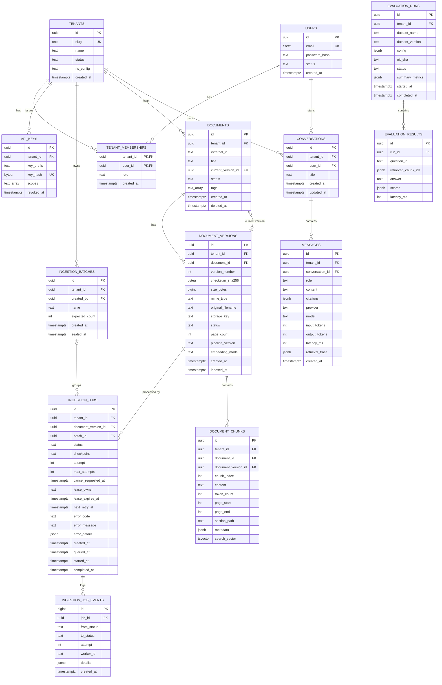

# NexusRAG — Database Design

> Status: **Proposed (Phase 0). Not final.** Section 2 explains the important decisions. Approve or challenge them before Phase 1 creates migrations.

## 1. What lives where

| Data | Store | Reason |
|---|---|---|
| Tenants, users, memberships, API keys | PostgreSQL | Relational, low volume, needs constraints. |
| Documents, versions, ingestion jobs, batches | PostgreSQL | **Source of truth for processing state.** Transactions and constraints enforce idempotency. |
| Chunk text + chunk metadata + full-text index | PostgreSQL | Needed for keyword search, citations and re-embedding. See decision D-3. |
| Embeddings + filter fields | Qdrant | Approximate nearest-neighbour search with filtering. |
| Original files | Object storage | Large binaries do not belong in Postgres (bloat, backups, vacuum). |
| Conversations, messages, evaluation runs | PostgreSQL | Relational, queried by tenant and user. |
| Rate-limit counters, query-embedding cache | Redis | Ephemeral. Losing it is harmless. |

## 2. Key design decisions

**D-1: `tenant_id` on every tenant-owned table, even when it can be derived through a join.**
- Every query can filter by tenant without joins, which makes "forgot the tenant filter" easy to spot in code review.
- It enables PostgreSQL Row-Level Security later as defense in depth (see [security in system-design](system-design.md#7-security)).
- **Composite foreign keys** such as `(tenant_id, document_id) → documents(tenant_id, id)` make it *impossible at the database level* for a chunk or version to point to another tenant's document. A bug in application code cannot create a cross-tenant link.
- Cost: one extra UUID column (16 bytes) per row and slightly wider indexes. Worth it.

**D-2: separate `documents` (identity) from `document_versions` (content).**
A document is the logical thing a user deletes or searches ("HR Policy"). A version is one immutable upload of its bytes. Jobs, chunks and vectors belong to a **version**. This gives:
- re-ingestion without downtime: the new version is indexed while the old one keeps serving, then `documents.current_version_id` is swapped in one transaction;
- clean rollback (point back to the previous version);
- unambiguous cleanup (delete everything for version X).

**D-3: chunk text is stored in PostgreSQL only. Qdrant stores vectors plus filter fields, not text.**

| | Text in Postgres only (**proposed**) | Text in both | Text in Qdrant only |
|---|---|---|---|
| Keyword search | Postgres FTS on the same rows | Same | Needs a separate engine |
| Duplication | None | 2× chunk text storage | None |
| Query cost | +1 indexed lookup by primary key (`WHERE id = ANY(...)`, ~1–3 ms) | None | None |
| Consistency | Single source of truth | Two copies to keep in sync on re-chunking and deletion | Can't join with metadata or permissions |
| Re-embedding with a new model | Read text from Postgres | Either | Must re-extract or scroll Qdrant |

The hydration lookup is not wasted work. It is also where the query path **re-checks authorization and currency**: same tenant, document not deleted, version is current. A stale Qdrant point (from a crash mid-cleanup, for example) can never reach the LLM.

**D-4: job state lives in PostgreSQL, not in Redis or Celery's result backend.**
Redis is only the delivery mechanism. If Redis loses messages, the sweeper rebuilds the work from Postgres. Celery's result backend is disabled for ingestion tasks.

**D-5: statuses are `text` + `CHECK` constraints, not native PostgreSQL `ENUM` types.**
Native enums can't have values removed or renamed easily inside migrations. A `CHECK` constraint is changed with an ordinary migration.

**D-6: primary keys are UUIDv7, generated in the application.**
- Safe to expose in URLs (not guessable sequential integers, which leak volume).
- Generated before insert, so IDs can be used for idempotency keys and Qdrant point IDs.
- v7 is time-ordered, so B-tree inserts stay at the right-hand edge of the index. Random v4 UUIDs scatter inserts across the index and hurt write performance at scale.

**D-7: deterministic chunk IDs.** `document_chunks.id = uuid5(NAMESPACE, f"{document_version_id}:{chunk_index}")`. The same ID is the Qdrant point ID. Re-running a stage upserts the same IDs, so duplicate chunks or vectors **cannot** be created by retries (see [ingestion-workflow.md §5](ingestion-workflow.md#5-idempotency)).

## 3. ER diagram



Tables added beyond the suggested list: `api_keys`, `ingestion_batches`, `ingestion_job_events`, `evaluation_results`. Each is justified in section 4.

## 4. Table notes, constraints and indexes

### tenants / users / tenant_memberships / api_keys
- `users` is global (one person can belong to several tenants). Membership carries the role. `CHECK (role IN ('owner','admin','member','viewer'))`.
- `api_keys.key_hash` = SHA-256 of the secret (high-entropy random keys don't need a slow hash like argon2). Only `key_prefix` is shown in the UI. The plaintext is shown once at creation. *Implemented in Phase 2.1 without `scopes` (added with roles in Phase 5); revocation via `revoked_at`.*
- `tenants.fts_config` (default `'english'`) is used to build `search_vector`, supporting assumption A-4.

### ingestion_batches
*Why it exists:* "1,000 documents per batch" needs a handle to track progress (`GET /v1/batches/{id}`), to list failures, and for benchmarks to measure end-to-end batch duration. Batch status is **derived** (aggregated job counts per status) rather than stored, to avoid a hot row that 1,000 concurrent workers would all update.

### documents
- `UNIQUE (tenant_id, id)`: target for composite foreign keys.
- `UNIQUE (tenant_id, external_id) WHERE external_id IS NOT NULL AND deleted_at IS NULL` (partial unique index). This enforces assumption A-1 and frees the identifier after deletion.
- `status`: `ACTIVE | DELETING | DELETED`. Retrieval only returns `ACTIVE`.
- `current_version_id`: FK to `document_versions(id)`, nullable until the first version is indexed. **A document with no indexed version is not searchable.**
- Index: `(tenant_id, created_at DESC)` for listing.

### document_versions
- `FOREIGN KEY (tenant_id, document_id) REFERENCES documents (tenant_id, id)`.
- `UNIQUE (document_id, version_number)`.
- **Duplicate detection:** `UNIQUE (tenant_id, checksum_sha256) WHERE status NOT IN ('DELETED','FAILED')`. Two concurrent uploads of the same file both try to insert. One wins and the other gets a unique violation, which the service maps to "duplicate → return the existing document". **The database, not a check-then-insert in application code, resolves the race.**
- `status`: `PENDING | PROCESSING | ACTIVE | SUPERSEDED | FAILED | DELETED`.
- `pipeline_version` + `embedding_model` record *how* the version was processed, so the system knows which documents need re-indexing after a chunker or model change.

### ingestion_jobs
- `FOREIGN KEY (tenant_id, document_version_id) REFERENCES document_versions (tenant_id, id)`.
- **One active job per version:** `UNIQUE (document_version_id) WHERE status NOT IN ('COMPLETED','FAILED','DEAD_LETTER','CANCELLED')`. Duplicate job submission is rejected by the database.
- `attempt` doubles as a **fencing token**. Every write a worker makes includes `WHERE id = :job AND attempt = :my_attempt`, so a worker that was presumed dead and later wakes up cannot overwrite a newer attempt's results.
- `lease_owner` / `lease_expires_at`: set when a worker claims the job and extended by heartbeat. Expired leases are recovered by the sweeper.
- `checkpoint` (`extract | embed`): the stage a `RETRY_PENDING` job resumes from. Embedding retries don't redo extraction.
- `cancel_requested_at`: cooperative cancellation for jobs in an active stage.
- `first_attempt_at` is derived from `ingestion_job_events`. It bounds the wall-clock retry deadline for throttling and outage errors.
- Indexes:
  - `(status, lease_expires_at)` and `(status, next_retry_at)`: sweeper scans;
  - `(tenant_id, batch_id, status)`: batch progress;
  - `(tenant_id, created_at DESC)`: listing.
- Status values and transitions are defined in [ingestion-workflow.md](ingestion-workflow.md#2-job-state-machine).

### ingestion_job_events (append-only)
*Why it exists:* one row per state transition gives a timeline per job for debugging ("why did this document take 4 minutes?"). It also gives exact **queue wait time** and **per-stage duration** metrics for benchmarks without extra instrumentation. Volume: ~8 rows per document, or 8,000 per 1,000-document batch, which is trivial. Prune or partition by month later if needed.

### document_chunks
- `id` is deterministic (D-7) and equal to the Qdrant point ID.
- `FOREIGN KEY (tenant_id, document_version_id) REFERENCES document_versions (tenant_id, id) ON DELETE CASCADE`.
- `UNIQUE (document_version_id, chunk_index)`.
- `search_vector tsvector GENERATED ALWAYS AS (to_tsvector(<config>, content)) STORED` with a **GIN index**. The FTS configuration must be fixed per generated column, so per-tenant languages would need an alternative column design. That is acceptable under assumption A-4 and flagged for later.
- Index: `(tenant_id, document_version_id)`.
- Keyword search joins `document_chunks → document_versions → documents` with `documents.current_version_id = document_chunks.document_version_id AND documents.status = 'ACTIVE' AND tenant_id = :tenant`.
- Expected size: 1,000 documents × ~30 chunks × ~4 KB ≈ 120 MB per batch including indexes. Comfortable for Postgres.

### conversations / messages
- `messages.citations` is a **JSONB snapshot** (document ID, version ID, title, page, chunk IDs, quoted span) captured at answer time. The citation stays meaningful even if the document is later re-versioned or deleted (assumption A-10).
- `messages.retrieval_trace`: candidate IDs, scores, and which retrievers matched. This is invaluable for debugging bad answers, and it is the data source for offline evaluation from real traffic.
- Token counts + provider + model per message → cost reporting (NFR-12).

### evaluation_runs / evaluation_results
- `config` stores the full retrieval and generation configuration (k values, fusion weights, reranker, model, prompt version) and `git_sha`, so **every metric is reproducible and attributable to a configuration**.
- Per-question results enable regression diffing between runs.

## 5. Transaction boundaries

| Operation | Transaction scope | Notes |
|---|---|---|
| **Upload registration** | 1 txn: upsert `documents` (by `external_id`), insert `document_versions`, insert `ingestion_jobs (PENDING)` | The object store write happens **before** the txn (S3 can't join a DB transaction). If the txn fails or the upload is a duplicate, the staged object is deleted, with an S3 lifecycle rule as the backstop for orphans. Enqueue happens **after** commit. |
| **Claim job** | Single `UPDATE … WHERE status IN (…) RETURNING` | Atomic compare-and-set. No explicit lock held across the task. |
| **Persist chunks** | 1 txn: delete existing chunks for the version + bulk insert new chunks + job → `EMBEDDING` (fenced by `attempt`) | Retry-safe: a re-run replaces rather than appends. |
| **Index (vectors)** | Qdrant upserts are outside any DB txn (idempotent by deterministic IDs) | Postgres is updated only after Qdrant confirms the write (`wait=true`). |
| **Complete** | 1 txn: job → `COMPLETED`, version → `ACTIVE`, previous version → `SUPERSEDED`, `documents.current_version_id` swap | Readers see either the old or the new version, never a mix. |
| **Delete document** | 1 txn: `documents.status = DELETING` + enqueue cleanup job row | Excluded from retrieval immediately. Cleanup is async and idempotent. |

## 6. Connection budget

Postgres connections are a real limit (default `max_connections = 100`):

```
API:     replicas × uvicorn workers × pool_size (+ max_overflow)
Workers: worker containers × celery concurrency × pool_size
```

Example: 4 worker containers × 8 prefork processes × pool size 5 = **160 connections**, which exceeds the default. The design uses **small per-process pools** (`pool_size=2`, `max_overflow=2`) in workers, and the connection budget is part of the scaling test plan. If more headroom is needed, add **PgBouncer** (transaction pooling) or RDS Proxy on AWS.

## 7. Deferred / to evaluate

- **Row-Level Security** as defense in depth (Phase 5 decision).
- **Document-level ACL tables** (`access_groups`, `document_access`) if FR-4.4 becomes a hard requirement. The Qdrant payload would then carry `acl_group_ids` for pre-filtering.
- **Partitioning** `ingestion_job_events` and `messages` by month: only if volumes justify it.
