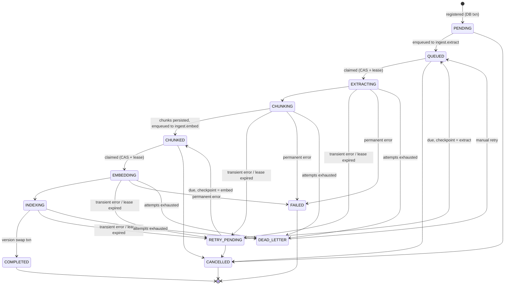

# NexusRAG — Ingestion Workflow

> Status: **Proposed (Phase 0)**. This is the most failure-prone part of the system, so it gets the most detailed design.

## 1. Pipeline stages and where they run

| # | Stage | Runs in | Input → Output | Notes |
|---|---|---|---|---|
| 1 | Upload | API | multipart stream → object in storage | Streamed in fixed-size chunks. SHA-256 computed on the fly. Never fully in memory. |
| 2 | Cheap validation | API | first bytes + size | Magic-byte type check, size limit, filename sanitizing. Rejects early, before any work is queued. |
| 3 | Registration | API | checksum + metadata → `document`, `document_version`, `ingestion_job` | One DB transaction. Duplicate detection via a unique constraint. Returns `202`. |
| 4 | Deep validation | Extract worker | object → OK / permanent failure | Parse-ability, encryption, page count, DOCX zip-bomb ratio. Too expensive for the request path. |
| 5 | Text extraction | Extract worker | object → page-wise text stream | Streaming, page by page (PDF) or element by element (DOCX/HTML). |
| 6 | Cleaning / normalization | Extract worker | raw text → clean text | Unicode NFKC, de-hyphenation, whitespace collapse, repeated header/footer removal, control-character stripping. For HTML, drop `script`/`style`/`nav`. |
| 7 | Chunking | Extract worker | clean text → chunks | Structure-aware recursive splitting (headings → paragraphs → sentences), ~500 tokens with ~10–15% overlap. Each chunk keeps its page range and section path for citations. |
| 8 | Metadata extraction | Extract worker | document → title, page count, author, dates, headings | Deterministic extraction only. No LLM calls in the core path (cost × 1,000 documents). |
| 9 | Embedding | Embed worker | chunks → vectors | Batched by count and tokens. Globally rate-limited. |
| 10 | Vector indexing | Embed worker | vectors → Qdrant points | Deterministic point IDs, `wait=true`. |
| 11 | Completion | Embed worker | → `COMPLETED`, version `ACTIVE` | Atomic version swap. Old version scheduled for cleanup. |

Each stage is a plain Python function with typed input and output, kept separate from Celery. Celery tasks are thin wrappers that claim the job, call the stage functions and record transitions. **Every stage is unit-testable without Redis, Qdrant or a network.**

### Why two worker queues instead of one task per document

| Option | Pros | Cons |
|---|---|---|
| One task does everything | Simplest. No intermediate state. | A provider failure during embedding re-runs extraction. CPU-bound and I/O-bound work share one concurrency setting. |
| One task per stage (5+ queues) | Maximum flexibility | Many hand-offs and intermediate artifacts. Hard to follow. |
| **Two queues: extract (CPU) + embed (I/O)** — proposed | Chunks in Postgres are a natural checkpoint. Each queue gets its own concurrency (cores vs provider limit). Retries resume at the failed stage. | One extra hand-off. |

See [ADR-0010](adr/0010-two-stage-worker-pipeline.md).

## 2. Job state machine



### Changes from the suggested state list, and why

1. **`PROCESSING` is not a stored state.** It is a derived grouping (`EXTRACTING | CHUNKING | EMBEDDING | INDEXING`) used in API responses and dashboards. Storing both a parent state and a sub-state invites the two disagreeing.
2. **`CHUNKED` is added.** It means "chunks are safely persisted and waiting for an embed worker". Without it, a job waiting in the embed queue would look like it is actively embedding. Queue wait time per stage could not be measured, and the sweeper could not tell "waiting" from "stuck".
3. **`SUPERSEDED` and `DELETED` are not job states.** They describe the *content*, not a processing run. A job finishes; a **version** gets superseded; a **document** gets deleted. They live on `document_versions.status` and `documents.status` (see [database-design.md](database-design.md)).
4. **`FAILED` vs `DEAD_LETTER` are kept distinct.** `FAILED` = permanent error (retrying is pointless: corrupt file, no text layer). `DEAD_LETTER` = retryable errors that exhausted their budget (an operator can replay after fixing the cause). They need different operational responses, so they get different states.

### Transition rules

- Transitions are defined in one table in `app/ingestion/state.py` (`ALLOWED: dict[Status, set[Status]]`). Any transition not listed raises an error. Unit tests enumerate every pair.
- Every transition is one **compare-and-set** SQL statement. Example claim:

```sql
UPDATE ingestion_jobs
SET    status = 'EXTRACTING',
       attempt = attempt + 1,
       lease_owner = :worker_id,
       lease_expires_at = now() + :lease,
       started_at = coalesce(started_at, now())
WHERE  id = :job_id
  AND  status = 'QUEUED'
RETURNING attempt;
```

  If zero rows come back, someone else owns the job, or it was cancelled, or it already finished. The task **acks the message and exits** without doing anything. This single statement is what makes duplicate message delivery harmless.
- Subsequent writes by that worker are **fenced** by the attempt number it received:
  `UPDATE … WHERE id = :job_id AND attempt = :my_attempt AND status = 'CHUNKING'`.
  A worker that was paused (GC, network partition) past its lease, and whose job was handed to another worker, finds its writes rejected.
- Every transition also inserts an `ingestion_job_events` row in the same transaction.

### Concurrency: why not `SELECT … FOR UPDATE`?

Row locks held for the duration of a task (seconds to minutes) would pin a database connection per running task and break if the worker dies mid-transaction. A **lease** (a timestamp, no held lock) plus a CAS on state gives the same mutual exclusion with no long-lived locks, and it recovers automatically when a worker dies.

## 3. Celery delivery semantics

| Setting | Value | Why |
|---|---|---|
| `task_acks_late` | `True` | Ack only after the task finishes. A crash mid-task means redelivery. |
| `task_reject_on_worker_lost` | `True` | If the worker process is killed (OOM, SIGKILL), requeue instead of acking. |
| `worker_prefetch_multiplier` | `1` | A worker reserves only what it is about to run. This avoids a crashed worker holding a backlog of reserved tasks, and it is the basis of queue backpressure. |
| `task_soft_time_limit` / `task_time_limit` | e.g. 15 / 20 min (extract) | Soft limit raises an exception so the task can record a clean failure. Hard limit kills runaway parsers. |
| `broker_transport_options.visibility_timeout` | > hard time limit (e.g. 1 h) | With Redis, unacked messages are redelivered after this timeout. If it is shorter than a long task, the task runs twice. CAS + lease make that harmless, but it should not be routine. |
| `worker_max_tasks_per_child` / `worker_max_memory_per_child` | e.g. 200 / 1 GB | Recycles processes, containing memory leaks in PDF libraries. |
| Result backend | disabled (`ignore_result=True`) | Job state lives in Postgres. |
| Message payload | `{"job_id": "…"}` only | Small messages. The worker always reads current state from the DB, so a stale message can't carry stale instructions. |

**Delivery is at-least-once. The design assumes every task can be delivered twice, possibly concurrently.**

### Why retries are scheduled through Postgres, not Celery's `retry(countdown=…)`

With the Redis broker, delayed (ETA/countdown) tasks are reserved and held **in worker memory** until due. That means many delayed tasks consume worker memory, they are lost from the queue's point of view while held, and if the countdown exceeds the visibility timeout they get redelivered and run twice. Instead:

1. On a transient error, the task computes `next_retry_at` and transitions the job to `RETRY_PENDING` (with `checkpoint` recording which stage to resume).
2. The **sweeper** (Celery beat, every 30–60 s) enqueues jobs whose `next_retry_at <= now()`.

Short waits (under ~10 s, for example an HTTP 429 with a small `Retry-After`) are handled **inline** inside the task with bounded retries. Only longer waits go back through `RETRY_PENDING`.

## 4. Failure handling and retries

### Error classification

| Class | Examples | Action | Uses attempt budget? |
|---|---|---|---|
| **Permanent** | Unsupported or mismatched type, corrupt or encrypted file, `NO_TEXT_LAYER`, exceeds page limit, zero extractable text | → `FAILED` with `error_code` | — |
| **Transient** | Timeouts, provider 5xx, connection reset, Qdrant 503, Postgres connection error | → `RETRY_PENDING`, exponential backoff | Yes |
| **Throttled / dependency outage** | Provider 429, circuit breaker open (Qdrant or provider down) | → `RETRY_PENDING`, backoff honoring `Retry-After` | **No**, but bounded by a wall-clock deadline (e.g. 6 h from first attempt) |
| **Crash / poison** | Worker OOM-killed, segfault in parser, lease expired | Sweeper → `RETRY_PENDING` | Yes, so a document that kills workers every time dead-letters after `max_attempts` instead of looping forever |

The third row matters at batch scale. If Qdrant is down for 10 minutes during a 1,000-document batch, counting those failures against the per-job budget would dead-letter hundreds of healthy documents. Throttling and outages are the **system's** fault, not the document's.

### Backoff

`delay = random_uniform(0, min(cap, base × 2^attempt))` ("full jitter"), with `base = 30 s` and `cap = 30 min`, or the provider's `Retry-After` if larger. Jitter prevents 1,000 failed jobs from retrying at the same instant and recreating the overload ("thundering herd").

### Circuit breaker

The embedding provider and Qdrant each have a breaker whose state is kept in Redis (shared by all workers). After N consecutive failures in a window it **opens**, and tasks immediately go to `RETRY_PENDING` without making the call. After a cool-down, one probe call is allowed (**half-open**). This stops 50 workers from hammering a service that is already down.

### Sweeper (reconciliation loop)

Runs every 30–60 s on the maintenance worker. Each rule is an idempotent SQL query:

| Condition | Meaning | Action |
|---|---|---|
| `PENDING` and `created_at < now() - 30s` | API committed but crashed or failed before enqueue | Enqueue, → `QUEUED` |
| `QUEUED`/`CHUNKED` and not claimed for > 15 min | Message lost (e.g. Redis restarted without persistence) | Re-enqueue (duplicates are harmless because of CAS) |
| Active stage and `lease_expires_at < now()` | Worker died | → `RETRY_PENDING` (or `DEAD_LETTER` if attempts are exhausted) |
| `RETRY_PENDING` and `next_retry_at <= now()` | Retry due | Enqueue to the stage's queue |
| `documents.status = DELETING` for > 5 min | Cleanup message lost | Re-enqueue cleanup |

Together with the after-commit enqueue, this is a lightweight version of the **transactional outbox** pattern. Postgres is the outbox, and the sweeper is the relay. It guarantees that **no committed job is ever lost because of the broker**.

### Heartbeats

Long tasks extend their lease every ~60 s (`UPDATE … SET lease_expires_at = now() + :lease WHERE id = :job AND attempt = :mine`). If the update affects 0 rows, the worker has lost ownership and aborts.

### Graceful shutdown

On SIGTERM (deploys, scale-in), Celery stops taking new tasks and lets running tasks finish within the stop timeout. Tasks that can't finish are killed. With `acks_late` the message is redelivered, and the lease expires and is reclaimed. ECS `stopTimeout` must exceed typical task duration (Phase 8).

## 5. Idempotency

The goal: **any stage can run any number of times with the same result as running once.**

| Mechanism | Prevents |
|---|---|
| `UNIQUE (tenant_id, checksum_sha256)` on live versions | The same file being registered twice (including concurrent uploads) |
| Partial unique index: one active job per version | Duplicate job submission |
| CAS state transitions | Two workers processing the same job concurrently |
| Attempt fencing | A zombie worker's late writes |
| Chunk persistence = delete-for-version + insert in one txn | Duplicate chunk rows on retry |
| Deterministic chunk / point IDs `uuid5(version_id:chunk_index)` | Duplicate vectors. Qdrant upsert overwrites the same ID. |
| After upsert, delete points of this version with `chunk_index >= chunk_count` | Leftover points if a retry produced fewer chunks |
| `Idempotency-Key` header on create endpoints (stored 24 h) | Client retries after a network timeout creating a second batch or upload |

## 6. Backpressure and rate limiting

Five layers, from the outside in:

1. **API admission control.** Per-tenant limits on in-flight jobs (e.g. 5,000) and on upload request size and file count. Over the limit → `429` with `Retry-After`. This is the **only** layer that bounds queue growth, since Celery/Redis queues are unbounded.
2. **The queue as buffer.** Uploads are fast; processing is slow. The queue absorbs the difference.
3. **Pull-based workers.** `prefetch_multiplier=1` + fixed concurrency means each worker processes exactly as fast as it can and no faster.
4. **Global provider rate limiter.** Celery's built-in `rate_limit` is **per worker process**, so with 10 workers it allows 10× the intended rate. Instead, a Redis **token bucket** implemented as an atomic Lua script is shared by all workers, with two buckets matching the provider's limits: requests/min and tokens/min. Before each embedding call the worker acquires `1` request + `Σ token_count` tokens (token counts are already known from chunking). If tokens aren't available within ~10 s, the job goes back to `CHUNKED` via `RETRY_PENDING` without consuming an attempt. A provider `429` sets a shared **cooldown key**, so *all* workers pause, not just the one that got the 429.
5. **Dependency protection.** Worker concurrency × pool sizes bound Postgres connections. Qdrant upserts are batched (~256 points, `wait=true`). Circuit breakers stop calls during outages.

**Tenant fairness (Phase 5):** a per-tenant cap on concurrently *claimed* jobs (Redis counter) keeps one tenant's 1,000-document batch from occupying every worker while another tenant's single document waits.

## 7. Handling a 1,000-document batch: walkthrough

1. Client `POST /v1/batches` → `batch_id`.
2. Client uploads in requests of up to ~50 files (configurable), sending `Idempotency-Key` per request so safe retries are possible. For each file the API streams to storage, hashes, and registers. Duplicates are reported as `duplicate` and create no job.
3. 1,000 rows `PENDING → QUEUED` in seconds. The queue now holds ~1,000 small messages (a few KB of Redis memory).
4. Extract workers pull one job each. Throughput ≈ `extract_workers × concurrency / avg_extract_seconds`.
5. Chunked jobs flow into `ingest.embed`. Embed throughput ≈ `min(provider TPM / avg tokens per doc, embed_concurrency / avg_embed_seconds)`.
6. The client polls `GET /v1/batches/{id}` (counts per status), or later subscribes via SSE.
7. Failures are isolated per document. The batch finishes as `completed`, `completed_with_errors` (some `FAILED`/`DEAD_LETTER`), or `in_progress`. `GET /v1/batches/{id}/jobs?status=FAILED` lists the failures with reasons.

### Back-of-envelope: what will limit throughput? (a hypothesis to measure in Phase 7)

Assume 1,000 documents × ~10 pages ≈ 10,000 pages, and ~15 chunks × ~500 tokens per document ≈ **7.5 M tokens to embed**.

- **Extraction:** text-layer PDF parsing is on the order of tens of pages per second per core. With 8 cores that is roughly a minute or less for 10,000 pages.
- **Embedding:** bounded by the account's tokens-per-minute limit. For example, at 1 M TPM, 7.5 M tokens takes **≥ 7.5 minutes regardless of worker count**.

**Prediction:** the embedding provider's rate limit, not the number of workers, will be the bottleneck. Adding workers beyond what saturates the TPM limit will not help. Phase 7 benchmarks will confirm or refute this. Specific numbers will not be claimed until measured.

### Memory safety for large documents

- API: streaming upload with a bounded buffer (e.g. 1 MB parts to S3 multipart).
- Worker: download to a temp file (disk, not RAM), then extract page by page with a generator. Chunks are produced incrementally and inserted in batches.
- Vectors for one document are held only per embedding batch (a few MB), not for the whole document.
- Per-process memory ceiling via `worker_max_memory_per_child`.

## 8. Versioning, re-indexing, deletion, cancellation

### New version of an existing document
1. Upload with `external_id` matching an active document and a different checksum → new `document_version` (`PENDING`) + job.
2. While it processes, retrieval keeps serving the **current** version (`documents.current_version_id` is unchanged).
3. Completion transaction: new version `ACTIVE`, old version `SUPERSEDED`, swap `current_version_id`.
4. A cleanup task deletes the old version's points from Qdrant, then its chunks. Its stored object is kept or removed per retention policy.
5. Between steps 3 and 4 the old points may still be returned by Qdrant, but **hydration drops them** because their version is no longer current. Correctness never depends on cleanup timing.

### Re-index (pipeline or chunker change)
Creates a new job for the **same** version. During the job, the version may briefly serve a mix of old and new chunks (chunk IDs are stable per index). This is acceptable for an admin-triggered operation. A zero-mixing alternative, generation-suffixed chunk IDs with an atomic generation flip, is noted for later. Changing the **embedding model** is different: build a new Qdrant collection, then switch an alias (blue/green at collection level).

### Deletion
1. `DELETE /v1/documents/{id}` → one txn: `documents.status = DELETING`, `deleted_at = now()`. Returns `202`. The document disappears from retrieval **immediately**, because hydration requires `ACTIVE`.
2. Active jobs for the document are cancelled (cooperatively: workers check document status between stages and before each upsert batch).
3. The cleanup task runs only when no job for the document holds a live lease (otherwise it reschedules). It then deletes Qdrant points by `document_id` filter, chunks, and stored objects, and sets versions and document to `DELETED`. Every step is idempotent.
4. A periodic **orphan reconciliation** (Phase 5) samples Qdrant points whose version is not `ACTIVE`/`PROCESSING` in Postgres and removes them. This is the backstop for any race not anticipated here.

### Cancellation
Allowed directly from `PENDING`, `QUEUED`, `CHUNKED`, `RETRY_PENDING` (via CAS). For a job in an active stage, `cancel_requested_at` is set. The worker checks it at stage boundaries and between embedding batches, then transitions to `CANCELLED` and cleans up partial vectors.

## 9. Ingestion metrics (emitted from day one of Phase 2)

`nexus_documents_received_total{tenant,mime}`, `nexus_jobs_transitions_total{from,to}`, `nexus_jobs_in_state{state}` (gauge, from DB), `nexus_queue_depth{queue}`, `nexus_queue_wait_seconds{stage}` (histogram, from event timestamps), `nexus_stage_duration_seconds{stage}`, `nexus_embedding_batch_seconds`, `nexus_embedding_tokens_total{provider,model}`, `nexus_ratelimit_wait_seconds`, `nexus_retries_total{error_class}`, `nexus_dead_letter_total`, `nexus_circuit_state{dependency}`.

Tenant labels are used only on low-cardinality counters, to keep Prometheus cardinality bounded.
